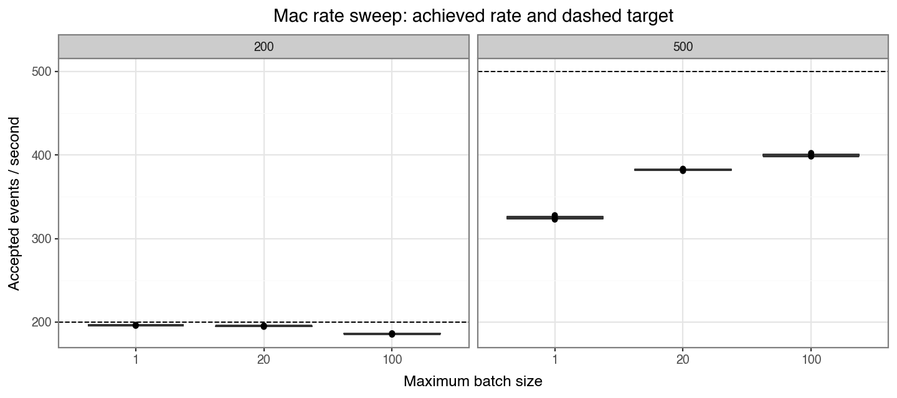
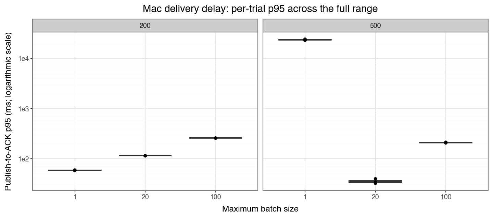
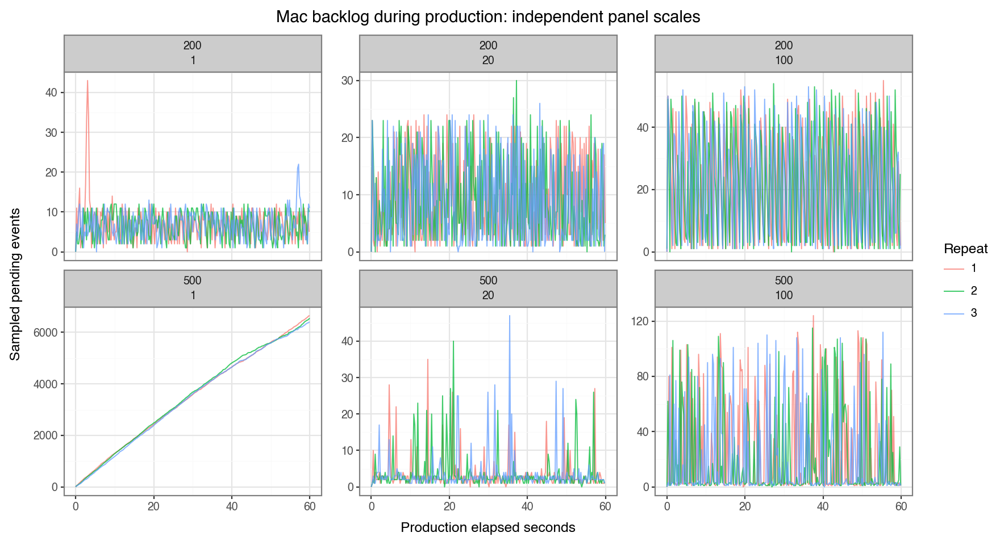

# Mac higher-rate batching comparison

Eighteen 60-second trials, three per rate/cap, reconciled **303,142 accepted
events**: 103,841 at target 200 and 199,301 at target 500. Every key/content
matched and received a local durable ACK. Zero rejection, pending, quarantine,
retry, or content discrepancies remained. An independent audit regenerated
seeded events and recomputed raw-ledger/SQLite timing and content.

**The 500 events/sec target was not achieved.** Cap 1 fell behind its achieved
input, building thousands of pending rows before a complete post-load drain.
Caps 20/100 kept pace with their lower achieved input during these trials.

## Throughput and delay

Rates are trial means; p95s are medians of trial percentiles. Delivery includes
post-window ACKs; ACK/sec counts only deletion commits inside production.

| Target/sec | Batch cap | Accepted/sec | ACK/sec in window | Delivery p95 (ms) | HTTP ACK p95 (ms) | Ending backlog |
| --- | --- | --- | --- | --- | --- | --- |
| 200 | 1 | 196.03 | 195.94 | 59.38 | 2.50 | 4–6 |
| 200 | 20 | 195.05 | 194.92 | 114.84 | 5.42 | 1–19 |
| 200 | 100 | 185.80 | 185.41 | 258.70 | 8.53 | 8–36 |
| 500 | 1 | 325.10 | 216.04 | 23427.58 | 2.57 | 6429–6653 |
| 500 | 20 | 382.31 | 382.27 | 34.41 | 2.78 | 1–3 |
| 500 | 100 | 399.79 | 399.52 | 207.92 | 3.25 | 2–44 |

At 200, cap 1 had the lowest delay. At 500, cap 20 had the lowest delivery
p95; cap 100 achieved the highest rate with fewer calls and a longer tail.
Cap 1's last ACK arrived 23.37–24.78 seconds after production ended.







All three 500/cap-1 queues grew throughout production. Other queues stayed
smaller during the observed minute; sampled curves do not prove indefinite stability.

## Actual batching and CPU

| Target | Cap | Mean actual batch | Calls/trial | Benchmark CPU | Collector CPU |
| --- | --- | --- | --- | --- | --- |
| 200 | 1 | 1.00 | 11762 | 53.67% | 23.79% |
| 200 | 20 | 3.44 | 3402 | 40.11% | 11.47% |
| 200 | 100 | 5.14 | 2173 | 45.83% | 9.01% |
| 500 | 1 | 1.00 | 19507 | 72.29% | 29.28% |
| 500 | 20 | 1.80 | 12740 | 68.74% | 28.49% |
| 500 | 100 | 2.65 | 9054 | 62.69% | 21.63% |

CPU uses one core = 100%, including drain; the long cap-1 drain changes its
measurement interval. Parent CPU includes generation/observation/upload work.

At 500, publish-call p95 was about 2.29–2.91 ms; 13–25% of calls exceeded the
2 ms target interval. Generation/preparation adds work outside that span.
The scheduler skips missed ticks. These observations fit the rate shortfall
but do not isolate a bottleneck. Profile before claiming optimization or capacity.
Cap 1's short HTTP ACK latency coexisted with long queue-driven delivery delay.

## Reproduce and limits

```bash
python3 -m benchmarks.run --duration 60 --repeats 3 --rates 200 500 --batch-sizes 1 20 100 --plots
```

Run start: `2026-10-14T01:28:55.852901+00:00`, MacBook-Pro-769.local,
Python 3.12.10, SQLite 3.49.1, macOS 26.6.2 arm64; seed 7, 16 MiB outbox,
100,000-row retention, 250 ms samples. Fresh trials rotated caps; all target-200
trials preceded target-500 trials. Allow about 20 minutes including drain.

[Shared measurement limits](benchmark-walkthrough.md) apply: same-host
contention, uncontrolled background work, no excluded warmup, sampled peaks,
and reused-parent/cache effects. This is neither maximum capacity nor a
Dell/Arduino measurement. The [100-target baseline](benchmark-report.md) was
a separate historical run. Its production hashes/dependencies matched; runner
setup/guards/archival changed, while timing calculations stayed unchanged.

[Curated evidence](benchmark-rate-sweep-mac.json) and
[raw data/source/audit](../benchmarks/results/rate-sweep-200-500-mac/) preserve
the measured version at dirty base commit
`504efd7fabcdd8062b896b4569a4af347861b5ce`. Raw results are ignored by Git.
Later cleanup/source edits do not change these historical measurements.
