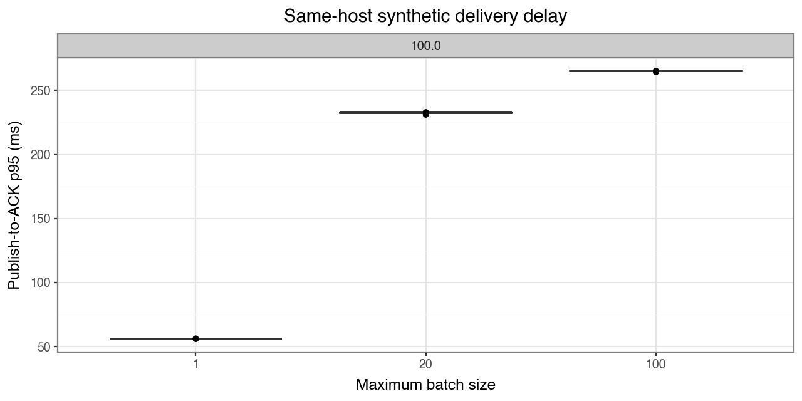
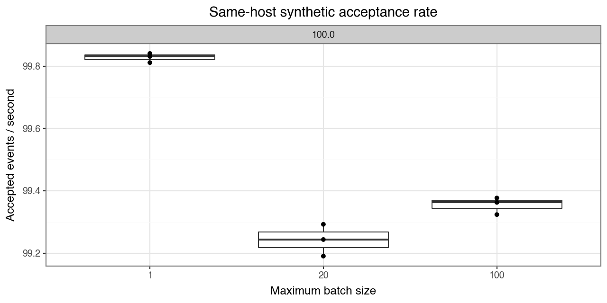

# Mac batching baseline

Nine 60-second trials at a 100 events/sec target, three per batch cap,
reconciled all **53,720 accepted events** and local durable ACKs. Zero rejected,
missing/extra/changed, pending, or quarantined outcomes remained.

Rates/counts are means across trials; p95 values are medians of per-trial p95s.

| Batch cap | Accepted/sec | Delivery p95 (ms) | HTTP ACK p95 (ms) | Actual mean batch | HTTP calls/trial |
| --- | --- | --- | --- | --- | --- |
| 1 | 99.83 | 56.11 | 2.45 | 1.00 | 5990 |
| 20 | 99.24 | 232.74 | 11.17 | 6.14 | 970 |
| 100 | 99.35 | 265.09 | 15.96 | 7.20 | 828 |

| Batch cap | Benchmark CPU | Collector CPU |
| --- | --- | --- |
| 1 | 29.36% | 12.35% |
| 20 | 41.78% | 7.14% |
| 100 | 41.79% | 6.95% |

Cap 1 had the lowest delay. Larger caps reduced HTTP calls and collector CPU,
with higher delay and benchmark CPU. Partial flushing produced actual batches
around 6–7, far below their caps. This does not identify an optimal cap at higher load.





## Reproduce and interpret

```bash
python3 -m benchmarks.run --duration 60 --repeats 3 --rates 100 --plots
```

Run start: `2026-10-14T00:25:38.439940+00:00`, MacBook-Pro-769.local,
Python 3.12.10, SQLite 3.49.1, 11 logical CPUs, seed 7. Trials used fresh
databases/source sessions/collectors; batch order rotated.

[Measurement definitions and shared limits](benchmark-walkthrough.md):
delivery starts before publish and ends after local deletion COMMIT; HTTP ACK
ends before deletion. CPU uses one core = 100% and includes drain. Parent
resources include observation/generation/upload work. Same-host contention,
uncontrolled background activity, reused-parent/cache effects, no excluded
warmup, and 250 ms sampling limit interpretation.

A separate five-second outage pilot reconciled 498 events; its exact 236-key
backlog recovered in 0.743 s after readiness. This validates the recovery
instrumentation, not sustained performance.

[Curated evidence](benchmark-baseline-mac.json) and
[raw data/source](../benchmarks/results/baseline-100-mac/) identify the historical
measured version, based on dirty commit
`504efd7fabcdd8062b896b4569a4af347861b5ce`. Later source edits were not measured
by this run. Raw results are ignored by Git; curated figures/JSON are retained.

Further results: [200/500 targets](benchmark-rate-sweep-report.md),
[COMMIT crashes](commit-crash-report.md), [demo overhead](demo-overhead-report.md).
Dell/Arduino performance remains unmeasured.
