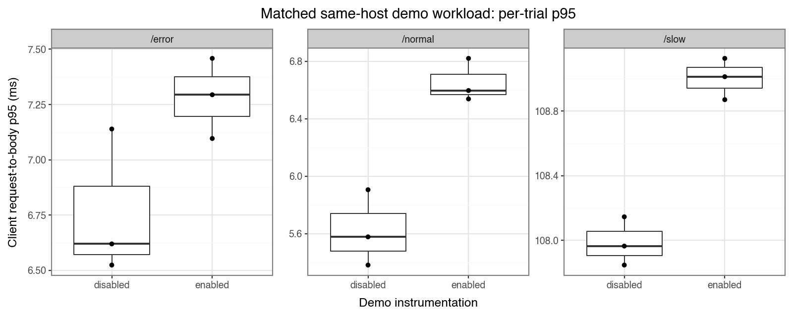

# Mac demo instrumentation comparison

Three matched pairs completed **36,000 HTTP requests** with expected bodies
and statuses. All **18,000 enabled-mode events** matched canonical content,
GET/route/status fields, and local durable ACKs. Disabled mode produced zero
telemetry. No recording errors, rejections, content discrepancies, pending rows,
or quarantine remained.

Each trial sent 6,000 requests with four clients: 2,000 each to /normal (200),
/slow (200 after 100 ms), and /error (500). Mode order alternated across pairs;
each trial started fresh demo/collector processes.

| Route | Disabled p95 (ms) | Enabled p95 (ms) | Paired increase (ms) |
| --- | --- | --- | --- |
| /normal | 5.58 | 6.60 | 1.02 |
| /slow | 107.96 | 109.01 | 0.98 |
| /error | 6.62 | 7.29 | 0.77 |

Mode values are medians of trial p95s; increases are medians of paired
enabled-minus-disabled values, so they need not equal differences of medians.
Error-route paired changes were +0.84, +0.77, and -0.04 ms.

Mean throughput: **106.39 requests/sec disabled**, **105.63 enabled**.
Median demo CPU: **0.77 ms/request disabled**, **3.02 enabled**; median paired
increase **2.27 ms/request**. Post-body recording consumes CPU beyond the
client-latency endpoint.



```bash
python3 -m benchmarks.demo_overhead --requests 6000 --concurrency 4 --repeats 3 --slow-delay .1 --plots
```

Run start: `2026-10-14T01:12:34.651625+00:00`, MacBook-Pro-769.local,
Python 3.12.10, SQLite 3.49.1, macOS 26.6.2 arm64.

Closed-loop clients wait for full bodies before their next request. Client
timing ends at body receipt; demo timing ends at ASGI final-body send before
publish. The runner separately waits for recording and local ACKs. Both modes
run the same initialized outbox/uploader/collector infrastructure.

Limits: CPU includes settling/drain; enabled parent auditing adds work; peaks
are sampled every 250 ms; no warmup is excluded. Reused-parent/cache effects,
background work, and same-host CPU/storage contention limit interpretation.
Three pairs describe this workload, not universal overhead or maximum throughput.
Dell/hardware verification remains pending.

[Curated evidence](demo-overhead-mac.json) and
[raw data/source](../benchmarks/results/demo-overhead-mac/) preserve the historical
measured version at dirty base commit
`504efd7fabcdd8062b896b4569a4af347861b5ce`. Raw results are ignored by Git.
Implementation: [crash/overhead walkthrough](failure-overhead-walkthrough.md).
