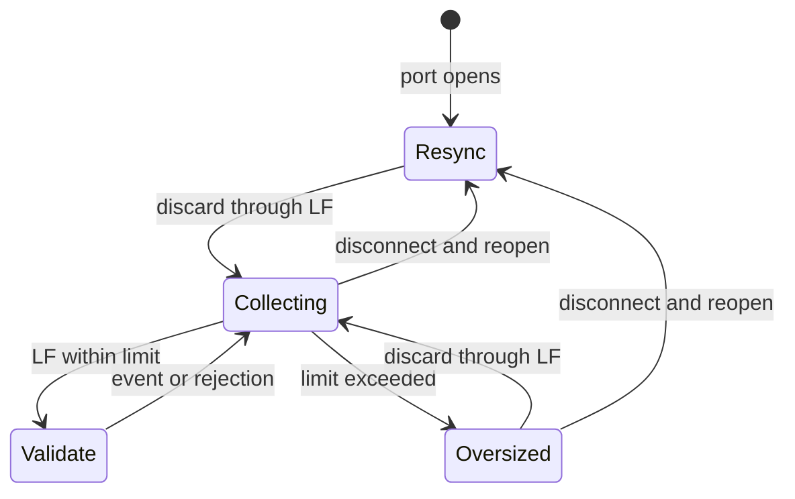

# Bounded serial ingestion

Read `NDJSONFramer` → `decode_frame` → `open_port` →
`SerialSource.poll_event` in [serial_source.py](../agent/serial_source.py), then
serial mode in [main.py](../agent/main.py). Coverage: [test_serial.py](../tests/test_serial.py).

Serial reads are byte chunks, not events: UTF-8 characters and JSON lines can
span reads. Decode only after LF. Reads retain at most 256 bytes; the partial
frame retains at most 1,023 bytes. The 1,024-byte wire limit includes LF and any
CR. A timeout leaves a partial frame intact.

Overflow counts once, clears the buffer, and discards through the next LF.
A valid-looking suffix of an oversized line cannot become an event.
Every port open discards through its first LF, including startup; this may
drop one valid unaccepted event. Disconnect/shutdown clear and count partial
and unprocessed prefetched bytes. Different connections never share fragments.



JSON parsing rejects invalid UTF-8, nonfinite constants, and duplicate members;
the strict union then validates payloads. Firmware source/boot IDs, sequence,
and uptime stay unchanged. Canonical storage normalizes formatting/defaults.
Empty lines, JSON errors, schema errors, and transport/discard failures have
separate fixed counters and bounded diagnostics.

Polling opens only the configured path after outbox ownership is acquired.
Read timeout is 0.01..0.5 s (default 0.1); reopen delay 0.05..60 s (default 1).
Stop interrupts retry waits. DTR/RTS are requested low before open, but drivers
may pulse them. Physical reset behavior remains to verify.

HTTP runs independently; slow SQLite can still pause reads. OS/USB buffers and
pre-acceptance loss are outside the durability guarantee. A decoded event is
accepted only when outbox publishing commits or finds identical pending content.
The reader closes before drain; committed rows survive restart.

`--count` counts offers, including duplicates/rejections. `valid_events` counts
decoded frames; a stop can occur before publication. Parser/sync discards alone
do not force a nonzero exit. Inspect counters as well as the exit code.
Source/boot report fields start null, then show the latest validated identity.

Run commands and the Dell port: [deployment.txt](deployment.txt).
Compatible firmware, baud, button/status contracts, physical sensors/USB, and
Dell retesting remain pending. Preserve the firmware baseline; exclude the servo.

The historical native pseudo-terminal check reconciled **1,063 unique events**
plus ten late replay duplicates, reconnect/new boot IDs, 50 pending events after
kill/outage, and SIGTERM drain. It exercised real pySerial/CLI/HTTP with simulated
input. [Evidence](serial-verification-mac.json) and
[raw source/data](../benchmarks/results/serial-check-mac/) preserve that version.

```bash
python3 scripts/verify-serial.py
```

References: [Python JSON](https://docs.python.org/3.12/library/json.html),
[Pydantic unions](https://docs.pydantic.dev/latest/concepts/unions/#discriminated-unions),
[TypeAdapter](https://docs.pydantic.dev/latest/concepts/type_adapter/),
[pySerial](https://pyserial.readthedocs.io/en/latest/pyserial_api.html).
